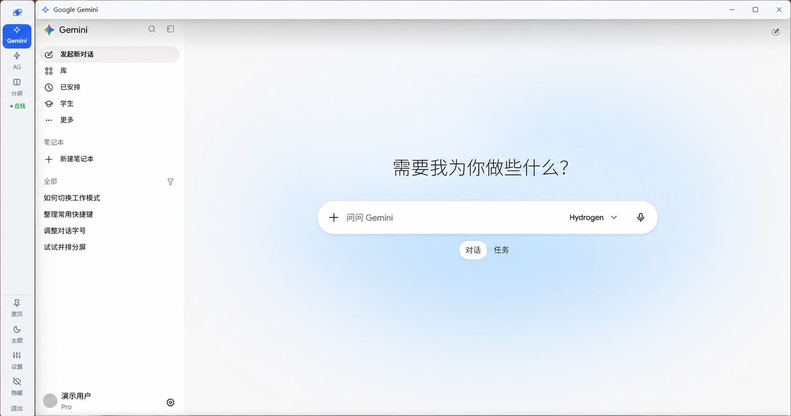
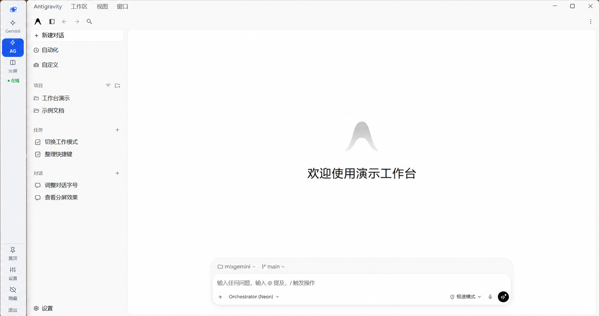
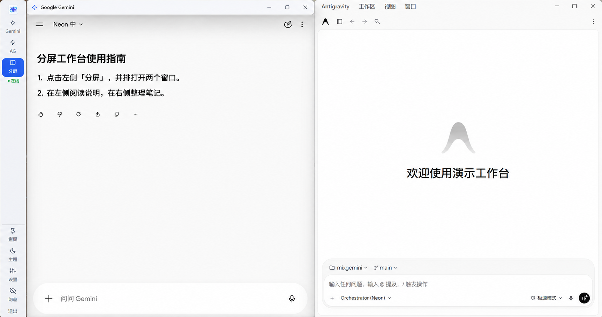
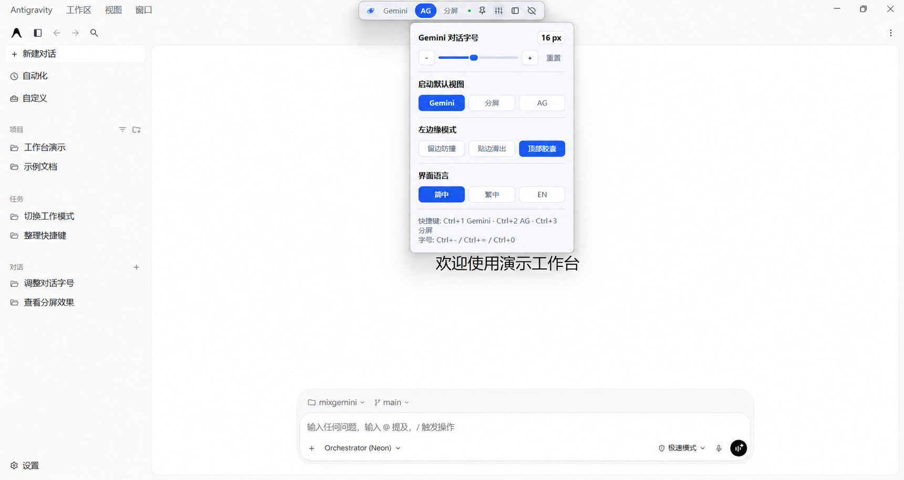

# MixGemini

将 **Gemini 网页聊天** 与 **Antigravity** 整合到一个统一工作台中的桌面切换器，支持**仅调整对话区字号**而不影响页面侧边栏和按钮。

## 核心特性

1. **三种工作视图（导航栏 / 快捷键）**：
   - `Ctrl+1` **Gemini 聊天**：全窗显示 Gemini 网页对话。
   - `Ctrl+2` **Antigravity 模式**：切换到 Antigravity 工作区，若未运行可一键启动。
   - `Ctrl+3` **并排分屏**：自动按当前显示器工作区左半屏 Gemini、右半屏 Antigravity 像素级贴合分屏（已处理 Windows DWM 透明边框偏移）。
2. **仅调整对话文字字号**：
   - 顶部栏 `-` / 滑块 / `+` / `重置`，或使用 `Ctrl+-`、`Ctrl+=`、`Ctrl+0`、`Ctrl+鼠标滚轮` 实时调节，不会缩小 Gemini 侧边栏与界面控件。
   - 通过 `adoptedStyleSheets` + `MutationObserver` 自动适配动态流式输出与页面切换。
3. **深浅主题 & 窗口置顶**：
   - 左侧栏底部支持深色 / 浅色主题切换、窗口置顶。
   - 登录态、字号、主题、窗口位置均自动保存在 `data/` 目录。

## 三种边栏模式

打开导航栏上的 **设置**，在 **左边缘模式** 中选择导航栏的显示方式。

- **留边防撞**　左侧常驻导航栏，工作窗口为它预留空间。
- **贴边滑出**　平时收起导航栏，鼠标移到屏幕左边缘时滑出，移开后自动收起。
- **顶部胶囊（默认）**　导航按钮集中在屏幕顶部的小工具栏，可直接切换 Gemini、AG 和分屏，也能打开设置。

## 界面预览

| Gemini 聊天 | Antigravity 工作区 |
| --- | --- |
| [](docs/screenshots/gemini.png) | [](docs/screenshots/antigravity.png) |

| 并排分屏 | 顶部胶囊与边栏设置 |
| --- | --- |
| [](docs/screenshots/split.png) | [](docs/screenshots/settings.png) |

## 启动方式

双击 [启动MixGemini.bat](file:///D:/Ddesktop/desktop/folder/codegemini/mixgemini/启动MixGemini.bat)，或在终端执行：

```powershell
python main.py
```
